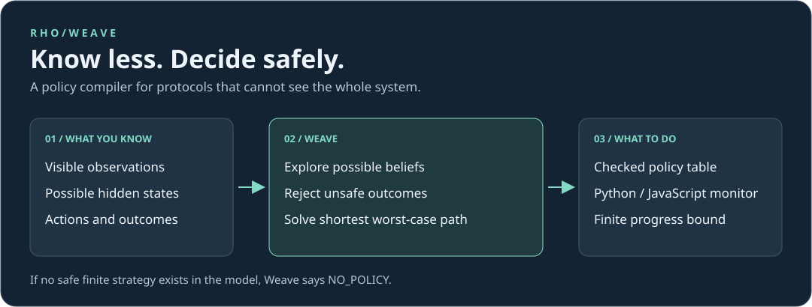
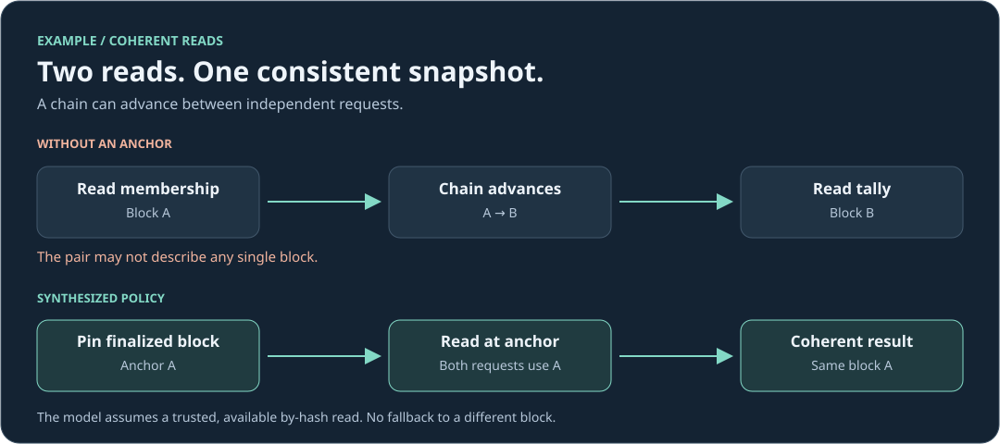
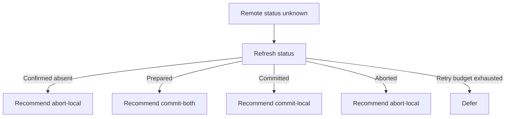
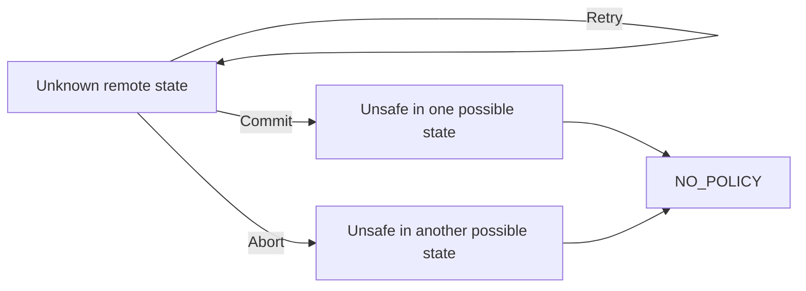
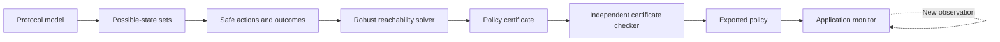
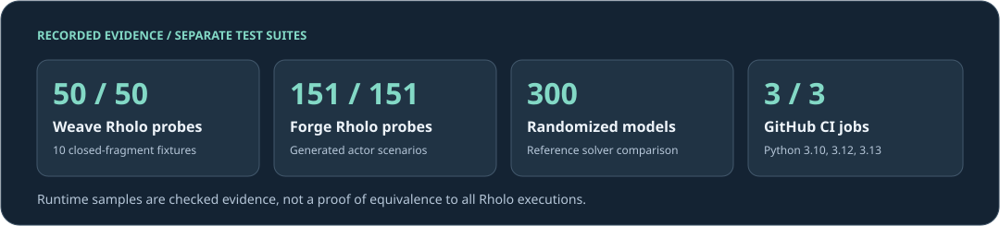

# Rho Weave

[](https://github.com/rhovision-org/rho-weave/actions/workflows/ci.yml)
[](https://www.python.org/)
[](LICENSE)



## Why I built this

A distributed system rarely knows everything about itself. A message may arrive late. A node may become unreachable. Two requests that look perfectly reasonable on their own may return data from different moments in time.

The interesting question is what a system should do when it doesn't have enough information.

I wanted to move some of that decision-making work out of manually written recovery branches and into a machine that can examine the possible situations before we choose an action.

Rho Weave takes a description of a protocol, including what can go wrong, and generates a decision policy. The idea is to give developers building on RhoVision a practical way to work with uncertainty rather than assuming it will disappear.

## What does that mean in practice?

Imagine sending a request to another system. It doesn't answer.

There are several possible explanations:

- The request never arrived.
- It arrived and is waiting to be processed.
- It was already completed.
- The connection failed before the response reached you.

All of those situations can look identical from your side. Acting as if a missing reply means a missing operation can be a serious mistake.

Weave considers the situations that are still possible, examines the actions available in each of them, and finds a strategy that reaches a declared safe outcome across every outcome included in the model.

Sometimes the answer is to gather more information. Sometimes there is an action that works in every possible situation. Sometimes no safe finite strategy exists.

Weave tells you which of those cases you are dealing with, within the model you provide.

## Example 1 — reading a changing blockchain

Imagine reading a list of members and then a voting tally. Between those two requests the blockchain may advance. The two results may not describe the same state of the system.



The [RhoGov example](examples/rhogov.json) models this problem. Weave generates a two-step policy:

1. Pin a finalized block.
2. Read both values at that same block.

This is an example of a small problem that becomes easier to reason about when the possible outcomes are written down. The included adapter requires a trusted finalized anchor and a transport that honors it. It rejects failed reads rather than falling back to another block.

It does not authenticate blockchain data or independently prove finality.

## Example 2 — recovering a transaction

The [Quantum OS example](examples/quantum-os.json) starts with a prepared local transaction leg and an unknown remote status.

Rather than treating the unknown status as proof that the remote leg does not exist, the synthesized policy asks for a fresh observation.



The maximum modeled decision horizon is two actions. Reaching a decision or explicitly deferring is the goal of this example. It is not a guarantee that a transaction has settled.

The model assumes an authoritative status provider. The optional JavaScript adapter returns a recommendation with `settled: false`; it never sends a transaction.

The source of this example is a pinned historical recovery table, not a claim that the current Quantum OS has a live vulnerability. See [the source evidence](evidence/SOURCE.md).

## Example 3 — when there is no safe answer

What if the other side remains unreachable indefinitely?

In the [partition example](examples/partition.json), committing is unsafe in one possible hidden state and aborting is unsafe in another. Retrying may leave us in exactly the same situation forever. The model does not allow deferring as a successful outcome.



Weave returns `NO_POLICY`. It does not invent a decision just to make the workflow finish.

This is one of the useful outcomes of the tool. It can show where a protocol needs another observation, action or a different definition of success. That is a design decision for the developer, not something the solver silently changes.

## How it works



Instead of tracking one guessed state, Weave tracks a *belief*: the set of states that could explain the observations so far.

An action must be available in all those states. Every modeled outcome of the action must remain safe and bring the policy closer to its goal. The solver chooses actions that minimize the maximum number of remaining decisions.

A certificate records the results. A separate checker verifies the reachable belief graph, the model binding and the policy's progress calculation before the CLI exports a usable table.

This is the difference between a fixed sequence of instructions and a policy that can branch according to what actually happens.

## Try it yourself

You need Git and Python 3.10 or newer. There are no third-party Python packages to install, no API keys and no running blockchain node required for the examples.

```bash
git clone https://github.com/rhovision-org/rho-weave.git
cd rho-weave

python3 -m rhoweave examples/rhogov.json
```

On Windows, you can use `py -3` instead of `python3`.

The result contains four reachable beliefs, three winning beliefs and an initial rank of two. The first allowed action is `pin-finalized`.

### 1. Generate a policy and its certificate

```bash
python3 -m rhoweave examples/quantum-os.json --output policy-cert.json --export policy.json
```

You now have two files:

| File | Purpose |
| --- | --- |
| `policy-cert.json` | The checked belief graph, ranks and admitted actions |
| `policy.json` | A policy table for the JavaScript monitor |

The output reports `WIN`, 13 reachable beliefs and an initial rank of two. Open the files to see how the solver represents the decision tree.

### 2. Check the certificate and replay an observation

```bash
python3 -m rhoweave examples/quantum-os.json --verify policy-cert.json --trace examples/quantum-os-trace.json
```

The trace starts with an unknown remote status. The refresh exhausts its retry budget, so the policy allows `defer`. The result shows `done: true` because the modeled decision task is complete.

This replay does not connect to Quantum OS or perform a settlement.

### 3. See what happens when the goal is impossible

```bash
python3 -m rhoweave examples/partition.json
```

The expected result is `NO_POLICY`, with exit code 1. This is a completed analysis, not a program crash.

| Result | Meaning | Exit code |
| --- | --- | ---: |
| `WIN` | A safe finite strategy exists for all initial observations | 0 |
| `NO_POLICY` | No such strategy exists in the supplied model | 1 |
| `UNKNOWN` | A resource limit prevented a conclusion | 2 |
| `ERROR` | Invalid input, failed verification or another handled error | 2 |

## Describe your own protocol

Start with the examples. A model has just four top-level fields:

| Field | Meaning |
| --- | --- |
| `name` | A description of the problem |
| `states` | Possible concrete situations and what the client can observe |
| `initial` | The situations that might be true at the start |
| `transitions` | What could happen after taking an action |

Here is a tiny complete model. The client cannot tell whether it is in state A or B. In either case, it can safely ask for confirmation.

```json
{
  "name": "Confirmation",
  "states": {
    "a": {"observation": "unknown", "safe": true, "goal": false},
    "b": {"observation": "unknown", "safe": true, "goal": false},
    "done": {"observation": "confirmed", "safe": true, "goal": true}
  },
  "initial": ["a", "b"],
  "transitions": [
    ["a", "confirm", "done"],
    ["b", "confirm", "done"]
  ]
}
```

Save this as `confirmation.json` and run:

```bash
python3 -m rhoweave confirmation.json
```

Weave will find a policy with a worst-case horizon of one action.

Try adding another possible outcome to `confirm` that is unsafe. If there is no alternative safe path, the answer changes to `NO_POLICY`. The compiler treats multiple listed outcomes as possibilities, not as probabilities.

The [model and integration guide](docs/POLICY.md) explains the input format, solver and limits in more detail.

## Use a policy in JavaScript

The included monitor is designed to sit between an application's decisions and its real actions. It does not perform those actions itself.

With Node.js 18 or newer, save this as `demo.mjs` in the repository root after generating `policy.json` above:

```js
import { readFileSync } from "node:fs";
import { PolicySession } from "./runtime/policy.mjs";

const table = JSON.parse(readFileSync("policy.json", "utf8"));
const session = new PolicySession(table, "unknown", table.model_sha256);

console.log(session.allowed()); // ["refresh"]

session.step("refresh", "retry-exhausted");
console.log(session.allowed()); // ["defer"]

session.step("defer", "deferred");
console.log(session.done); // true
```

```bash
node demo.mjs
```

These are synthetic observations for a local tutorial. In an application, check the allowed actions before executing an external operation and advance the monitor only using authenticated observations. Use an independently trusted model and policy artifact; copying the model hash from the table itself does not authenticate it.

The monitor rejects a disallowed action and invalidates its session on an unexpected observation. The application must serialize operations and decide how to handle transport failures.

See [the two client adapters](runtime/adapters.mjs) for a coherent-read example and a recovery recommendation example.

## From Rholang to a policy

Weave also has a compiler for a small, finite fragment of Rholang.

It supports private names, nested scopes, parallel processes, one-shot receives, joins and sends carrying `Nil`. It explores possible internal communication schedules instead of picking one execution and assuming every other execution will be the same.

```bash
python3 -m rhoweave.rholang examples/coherent-read.rho --input pin --input read --input unsafe_read --goal coherent --forbid mixed --output compiled.json
python3 -m rhoweave compiled.json --output compiled-cert.json --export compiled-policy.json
```

This produces a model from source, then a checked policy for that model. It does not accept unrestricted Rholang, recursive contracts or arbitrary data expressions. See [the supported grammar and execution semantics](docs/COMPILER.md).

### A portable version

```bash
python3 tools/build_zipapp.py rho-weave.pyz
python3 rho-weave.pyz --version
python3 rho-weave.pyz examples/rhogov.json
```

The zipapp contains the Python CLI and can run outside the checkout with a compatible Python interpreter.

## Rho Forge — another part of the project

The [Forge component](forge/README.md) approaches the problem from the other direction. Instead of generating a decision policy for an uncertain protocol, it generates a stateful Rholang actor from a finite resource workflow.

```bash
cd forge
python3 -m rhoforge examples/escrow.json --out build-escrow
cd ..
```

Its synthetic escrow example turns three funding steps and a reservation into a single buyer-authorized `open` operation. The seller's release remains a separate role capability. The generated [factory](forge/examples/generated/factory.rho) and [manifest](forge/examples/generated/manifest.json) are included in the repository.

Forge and Weave are different components with separate validation suites. [Rho Foundry](https://github.com/rhovision-org/rho-foundry) is a related standalone project; it has its own specification format and runtime evidence.

## What has actually been tested?



| Check | Recorded result |
| --- | --- |
| Weave model solver | 300 seeded randomized comparisons with a reference solver |
| Weave Rholang fragment | 50/50 sampled Rholo executions within predicted outcome sets |
| Forge generated actor | 151/151 exploratory executions matching the reference interpreter |
| Hosted offline CI | 3/3 Python matrix jobs passed, with JS and Forge checks |

The runtime evidence comes from a pinned native Rholo binary, with synthetic keys in an isolated loopback-only devnet. Both recorded experiments had zero peers and unchanged block height. They did not execute signed transactions on an existing network.

The hosted CI checks the recorded evidence and its consistency with the source; the native runtime probes are reproducible separately. The observations cover the recorded fixtures, not every scheduler outcome or arbitrary Rholang program.

- [Successful hosted CI run](https://github.com/rhovision-org/rho-weave/actions/runs/45786310654)
- [Weave runtime observations](evidence/rholo-runtime-probes.json)
- [Forge runtime observations](forge/evidence/runtime.json)
- [Native runtime reproduction guide](docs/RUNTIME.md)
- [Pinned source comparisons](evidence/SOURCE.md)

Run the offline checks:

```bash
python3 -m unittest discover -s tests -v
node runtime/test.mjs policy.json
python3 -m rhoweave examples/rhogov.json --export gov-policy.json
node runtime/test-adapters.mjs gov-policy.json policy.json
```

Generate `policy.json` using the Quantum OS example in the earlier tutorial before running the JavaScript tests.

## Where this could fit in RhoVision

I see Weave as a small layer that developers can use while designing protocols or implementing their clients. It gives us a way to make assumptions visible: what can the system observe, what is allowed, what can go wrong and when can we safely stop?

It is independent of the core projects. It does not replace Rholo, change a validator, modify a contract on a live chain or add a required dependency to another repository.

The important boundary is the model itself. If we omit a real failure mode, label an unsafe state as safe or trust a false observation, a policy cannot correct that mistake for us. The solver works on finite models; its belief space can grow exponentially. It reports resource exhaustion instead of claiming impossibility.

At this stage, the project is an executable research tool with bounded runtime validation. It does not provide authenticated network observations, distributed atomicity or guaranteed progress through arbitrary real network partitions. It is not a production settlement engine.

## Repository map

| Path | Contents |
| --- | --- |
| [rhoweave/](rhoweave/) | Solver, certificate checker, CLI and source compiler |
| [examples/](examples/) | Protocol descriptions and sample observation traces |
| [runtime/](runtime/) | JavaScript monitor, adapters and tests |
| [forge/](forge/) | Resource-workflow compiler and generated actor |
| [evidence/](evidence/) | Pinned source and runtime results |
| [docs/](docs/) | Technical guides and illustrations |
| [SECURITY.md](SECURITY.md) | Trust assumptions and operating boundaries |

## Contributing

If a protocol has a decision that is difficult to reason about, describe the possible states and outcomes first. Small examples that expose an ambiguity or a missing action are especially valuable.

A reproducible model and the expected result are a good starting point for a contribution.

## License

Rho Weave, including its Forge component, is released under the [Apache License 2.0](LICENSE).

You can use, modify and redistribute the project under the terms of that license. External projects and runtime artifacts remain subject to their respective licenses.
