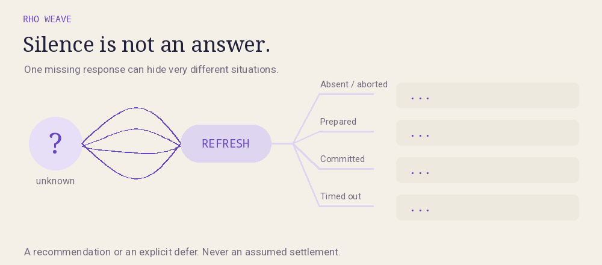

# Rho Weave

**What should a system do when it does not know enough?**

[](https://github.com/rhovision-org/rho-weave/actions/workflows/ci.yml) [](LICENSE)

Created by **[AixAria](https://github.com/aixaria0)** ([@aixaria0](https://github.com/aixaria0)).

You send a request. Nothing comes back.

Maybe it never arrived. Maybe it is waiting. Maybe the operation finished and only the reply was lost. From your side, all three look the same.

In a distributed system, choosing the wrong explanation can be worse than waiting.

Rho Weave is my attempt to turn that uncertainty into something we can work with. Instead of writing a recovery branch for one assumed state, describe the possible states, actions and outcomes. Weave searches for a safe strategy that reaches your stated goal across those possibilities.



[Still image](docs/motion/overview.png) · [How the animation was made](docs/motion/README.md)

## What comes out?

A decision policy, not just a warning.

For example, a recovery model inspired by Quantum OS starts with an unknown remote status. The synthesized first action is to refresh. If the response says prepared, committed or absent, different recommendations follow. If the retry budget is exhausted, the modeled policy defers.

If no strategy can both stay safe and finish under the supplied rules, Weave returns `NO_POLICY`. It does not pretend uncertainty has gone away.

Try this with the [RhoGov coherent-read model](examples/rhogov.json): Weave chooses to pin one finalized block and read at that same block, rather than combining values from two different snapshots.


## A two-minute experiment

Git and Python 3.10+ are enough. No blockchain node or Python packages are needed.

```sh
git clone https://github.com/rhovision-org/rho-weave.git
cd rho-weave
python3 -m rhoweave examples/quantum-os.json --output certificate.json --export policy.json
```

The supplied example returns WIN with a worst-case bound of two decisions. You get a certificate and a policy table that can be used with the included JavaScript monitor. Replay a case where the status remains unknown:

```sh
python3 -m rhoweave examples/quantum-os.json --verify certificate.json --trace examples/quantum-os-trace.json
```

Try the opposite: a model with an indefinite partition and no permissible defer.

```sh
python3 -m rhoweave examples/partition.json
```

It returns NO_POLICY (exit code 1). A resource limit instead produces UNKNOWN; the two results mean different things.

## For people building protocols

### Resume an interrupted reservation

Compile a Forge workflow or an enumerated Foundry contract. Give Weave its machine artifact and describe the possible starting markings, the goal, the observations and the allowed operations. Weave derives the model and generates a recovery controller in Rholang.

The [reservation demo](docs/RECOVERY.md) recovers after an issuance reply is lost. The controller reads the actor, chooses its next authorized operation and advances only on the expected reply and revision. A request through the wrong capability defers. The example runs against a pinned native Rholo node.

Weave tracks sets of states consistent with the visible observations. It constructs the reachable belief graph, then solves a finite robust reachability game. Each admitted action reduces the worst-case remaining decision count, and a separate certificate checker verifies the graph and rank calculation.

It can also compile a restricted one-shot Rholang fragment into a model. The Python and JavaScript monitors check policy admission; they do not execute network actions. Included adapters demonstrate coherent reads and recovery recommendations.

The modeled decision can be safe while a real implementation is still unsafe. The model must cover relevant failures; observations and side effects remain the caller's responsibility. A recovery recommendation is not settlement.

- [Full walkthrough and JavaScript example](docs/GUIDE.md)
- [Model format and solver](docs/POLICY.md)
- [Rholang fragment compiler](docs/COMPILER.md)
- [Native Rholo reproduction](docs/RUNTIME.md)
- [Security boundaries](SECURITY.md)

Recorded evidence includes 300 randomized solver comparisons and 50 sampled native Rholo executions across ten closed-fragment fixtures. The [raw observations](evidence/rholo-runtime-probes.json) are included. This is bounded validation, not a proof for arbitrary Rholang or arbitrary networks. [CI](https://github.com/rhovision-org/rho-weave/actions) reports the latest offline checks.

## The Rho family

- **[Rho Observer](https://github.com/rhovision-org/rho-observer)** — See what the network actually reports.
- **[Rho Forge](https://github.com/rhovision-org/rho-forge)** — Turn resource flows into executable actors.
- **[Rho Foundry](https://github.com/rhovision-org/rho-foundry)** — Turn guarded rules into executable contracts.

Weave derives policies from Forge and enumerated Foundry artifacts. Observer supplies a block anchor to applications that read external state by hash. Each tool also runs independently. [How the projects fit together](docs/ECOSYSTEM.md)

## License

[Apache License 2.0](LICENSE). External software remains under its own license.
