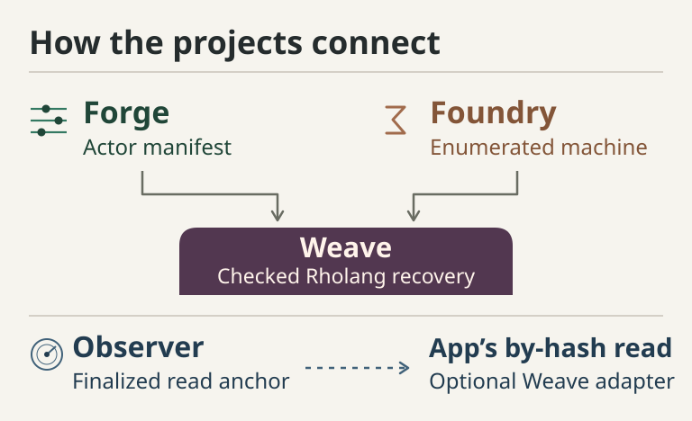

# From a reservation rule to a recovery action

A box office needs to count seats, recover when a reply gets lost, and sometimes read state from a particular finalized block. Those are three different jobs. The four projects have standalone entry points, and they share a few explicit interfaces.

| Input | Current consumer | Scope |
| --- | --- | --- |
| [Forge](https://github.com/rhovision-org/rho-forge) flat `rho-forge/v1` or partitioned `rho-forge/partitioned-v1` manifest | [Weave](https://github.com/rhovision-org/rho-weave) recovery compiler | The application selects an instance and role. For a partitioned manifest, it also selects the lane with `--lane`. |
| [Foundry](https://github.com/rhovision-org/rho-foundry) schema `1` enumerated machine | Weave recovery compiler | The finite table supplies authorized transitions. The selected machine has to fit Weave's state budget. |
| Foundry `rho-foundry/symbolic-v1` manifest | Application calling the generated arithmetic contract | The manifest describes the contract's counters and roles. Use the enumerating backend to generate a machine for Weave recovery. |
| [Observer](https://github.com/rhovision-org/rho-observer) `rho-observer/read-anchor/v1` response | An application's by-hash transport, optionally through `rhoweave.anchor.anchored_read` | The caller provides the expected network and shard, the observation fetch and the trusted read callback. A withheld or expired anchor stops the read. |

Weave compiles a controller alongside the actor. The caller supplies the capabilities from the actor represented by the manifest. Its revision checks apply within that instance. Observer supplies evidence for a separate read, leaving authority with the actor and authentication with the application. Combining multiple independent lanes in one atomic workflow requires a coordination protocol.

The native integration run used generated Forge and enumerated Foundry contracts in a standalone Rholo node. It exercised the Observer adapter's rejection of a checkpoint with no finalized fringe as a separate case. For a finalized-network application, the adapter accepts a qualifying Observer envelope and requires the response to match the requested network, shard and block hash. [Walkthrough](https://github.com/rhovision-org/rho-weave/blob/main/docs/RECOVERY.md) · [Native integration run](https://github.com/rhovision-org/rho-weave/actions/runs/45809327924)
