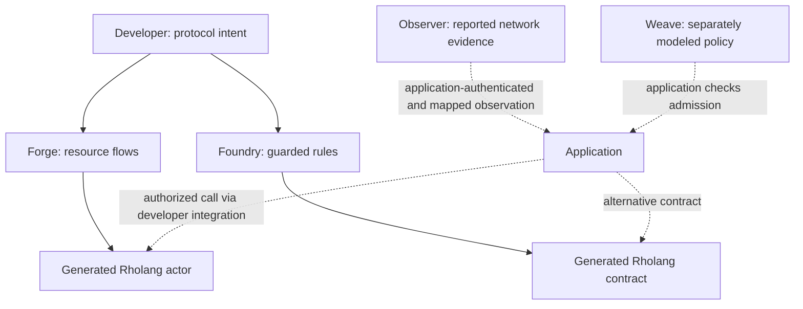

# Four tools, four questions

The projects explore different parts of building on RhoVision. Each can be used independently, with its own input format, release and tests.

| Project | What goes in | What comes out | What is not supplied |
| --- | --- | --- | --- |
| [Rho Observer](https://github.com/rhovision-org/rho-observer) | Operator-configured Rholo/RChain HTTP endpoints | Cached observations, coverage, verdict, health/readiness and bounded ancestry evidence | Independent Casper consensus validation or transaction authorization |
| [Rho Weave](https://github.com/rhovision-org/rho-weave) | Finite possible states, observations, actions, outcomes and safety/goal labels | Checked decision-policy certificate, exported policy and finite worst-case action bound when winning | A complete real-world model, authenticated observations or transaction execution |
| [Rho Forge](https://github.com/rhovision-org/rho-forge) | Bounded places, consume/produce transitions, roles, conservation weights and mission markings | Rholang factory, resource markings and authorized primitive plans | External asset movement, durable recovery or identity management |
| [Rho Foundry](https://github.com/rhovision-org/rho-foundry) | Integer resources, guards, deltas, invariants, roles and goal predicates | Rholang factory and machine-readable reachable state graph | Arbitrary Rholang compilation or external effects |

## One possible application design

Imagine a reservation application. A developer could choose Forge **or** Foundry to generate the internal resource-management actor. Forge would express available, held and sold units as places with consume/produce transitions. Foundry would express them as integer resources with deltas, guards and invariant predicates.

Before an external action, an application could ask Observer for a fresh evidence report. Observer compares reports; it does not decide whether a transaction is authorized. A separately authored Weave model could express the possible states of an interrupted workflow and generate a checked policy for the permitted next action.

The following drawing is a possible design, not an implemented cross-project interface.

The application remains responsible for model-to-implementation correspondence, observation authentication, side-effect ordering, authorization, network failures and deployment. None of the four repositories currently supplies an automatic composition layer.

## Choosing between Forge and Foundry

| Detail | Forge | Foundry |
| --- | --- | --- |
| State representation | Bounded resource places and markings | Bounded integer resource vectors |
| Primitive action | Consume and produce quantities; single role | Integer deltas, linear guards; one or more roles |
| Invariants | Conservation equalities checked for every primitive | Linear equality/inequality predicates checked on reachable states |
| Goal | Role-specific target marking | Role-specific target predicates and allowed action subset |
| Interface | Publicly named factory; separate view capability; replies include primitive plan | Caller-scoped factory; role-specific send-only capabilities; inspect operation |
| Already satisfied goal | Non-mutating ALREADY reply | No mutating goal rule for that state |
| Current state budget | 128 reachable markings | 2,048 reachable states |

Neither comparison implies performance superiority. These are separate finite-model compilers with overlapping goals and different interfaces. No automatic model conversion is provided.

## Evidence boundaries

Observer has a documented hosted Rholox consumer and historical deployment evidence. That is different from a formal network consensus certificate. Weave has bounded model tests and sampled native Rholo observations. Forge and Foundry have distinct native runtime fixture suites. Check each repository's own CI, evidence and limitations; do not combine their counts into a claim of end-to-end integrated validation.

The four tools share a direction, not an assumed guarantee.
